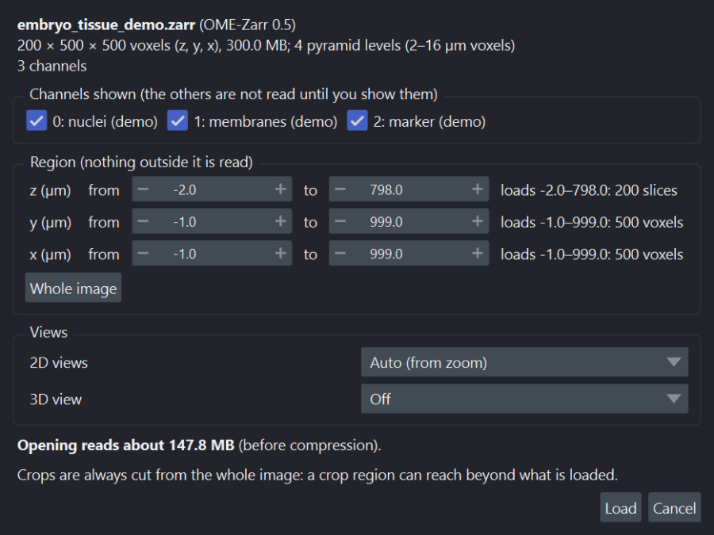
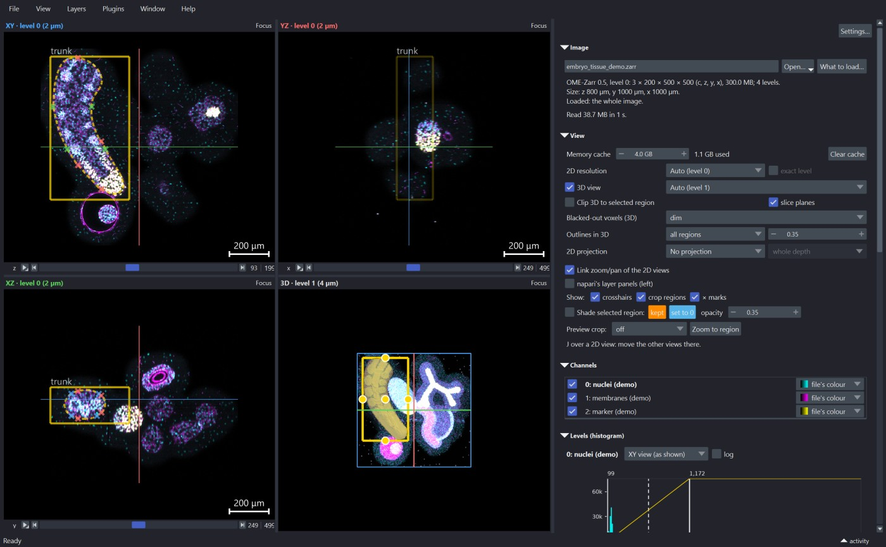
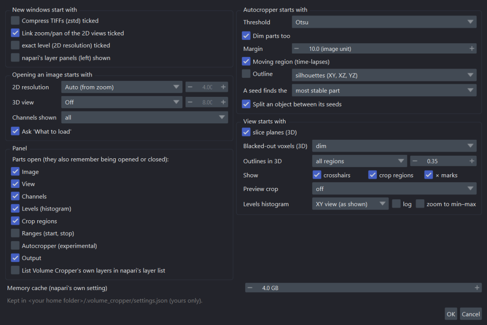
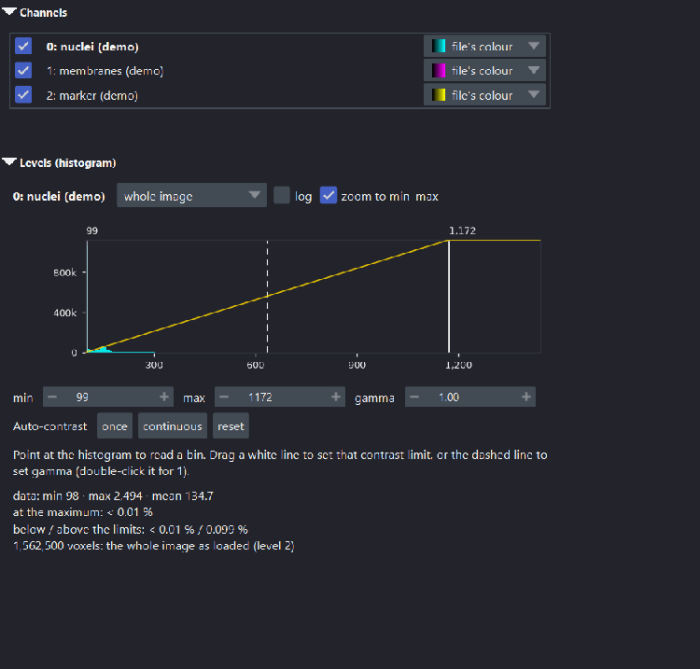
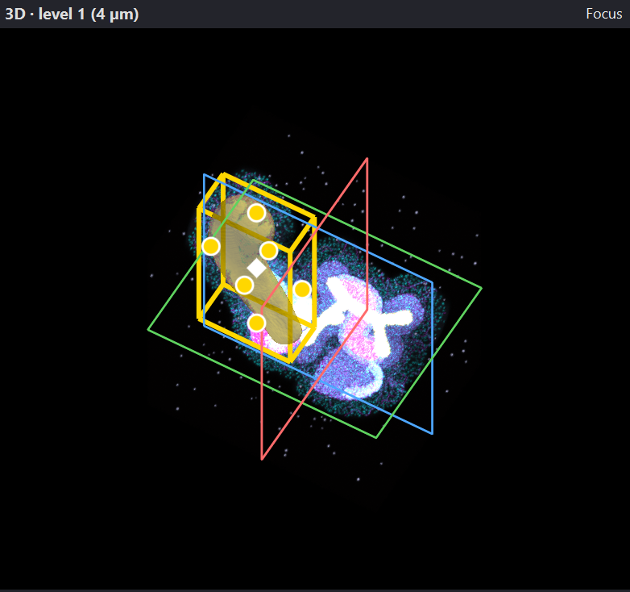

# About Volume Cropper

Volume Cropper cuts regions out of large 3D images saved as **OME-Zarr**,
version 0.4, 0.5 or 0.6 (for example lightsheet data converted with
eubi-bridge), also zipped into one file (`.ozx`, `.zip`), and saves each
region as a new OME-Zarr image of the same version, at full resolution
and with all its resolution levels. It runs in
**napari**, a Python image viewer.

What it does for you:

- asks first what to load (channels, a region, resolution), then shows the
  image in four linked views (XY, YZ, XZ and 3D), reading only that part
  and only what is on screen, so even images of a terabyte open quickly;
- lets you draw crop **regions**: boxes, shaped by freehand **outlines**, and
  preview exactly what will be saved, in 2D and 3D;
- writes each crop as a complete OME-Zarr (same chunks, compression and
  metadata as the source), checks it against the source, and records where
  it came from (provenance); it can also save a region as a **TIFF for
  Fiji**;
- crops in time too: a range of timepoints, or every n-th one;
- also opens **TIFF, OME-TIFF and microscope files** (Leica LIF, Zeiss CZI,
  Nikon ND2, Olympus OIR): these are read into memory, and their crops are
  TIFFs (see *Other files*);
- **Autocropper (experimental):** fits a region to a bright object by
  itself, for example a single embryo, also over time, with a region that
  moves with the object (see *Autocropper*);
- can be used from napari's own menus as well (an optional plugin).

The source image is only ever read, never changed.

**This is a beta version**, for testing within the group. Please report
problems and wishes to the maintainer: what you did, what you expected,
and what happened. A screenshot of the window and of the terminal window
(see *Installing it*) helps most.

**In this guide**, `<tool folder>` is the folder that holds Volume Cropper
(with `volume_cropper.bat`, `volume_cropper.sh` and the `env` folder): a
shared copy on your group's network drive, if your group keeps one, or
your own copy (see *Your own copy*), for example one downloaded from the
tool's GitHub repository. `<image>.zarr` is an image to crop, and
`<output folder>` a folder of your own for the results.

# Installing it

You install one thing yourself: a conda **environment**, a self-contained
set of Python packages. The command below creates an environment called
**`volume_cropper`**, with the Python version and the packages (napari and
its helpers, in fixed versions) listed in the tool's file
`env/environment.yml`. Nothing else on your computer changes, and the
launcher switches to this environment by itself. The tool itself stays in
`<tool folder>` on the network drive, so everyone uses the current version
(you can also keep a copy of your own: see *Your own copy*). Installing
takes 5 to 15 minutes and about 3 GB of disk space, once.

**You need:**

- access to `<tool folder>` and to your images;
- **conda**: Miniforge, Miniconda or Anaconda. If you have none, install
  Miniforge from <https://github.com/conda-forge/miniforge> ("just for me"
  is fine).

Please don't change or add files in `<tool folder>`; tell the tool's
maintainer about problems and wishes.

## Windows

1. **Find the tool folder** in File Explorer (a shared copy is on the
   network drive). Note its path: click the address bar to see it.
2. **Create the environment (once).** From the Start menu, open
   **Miniforge Prompt** (or **Anaconda Prompt**) and type:

   ```
   conda env create -f "<tool folder>\env\environment.yml"
   ```

   Tip: type `conda env create -f ` (with a space at the end) and drag the
   file `environment.yml` from the tool's `env` folder into the window; this
   fills in its path. Press Enter and wait until it says `done`. You now
   have the environment `volume_cropper`.
3. **Start Volume Cropper**, in either of two ways:
   - **double-click** **`volume_cropper.bat`** in the tool folder; or
   - **from a terminal** (Miniforge Prompt, or Windows' Command Prompt):
     drag `volume_cropper.bat` into the window (this types its path),
     optionally add an image and options (see *Options when starting*), and
     press Enter.

   A **terminal window** opens first (when you double-click, a new black
   window; leave it open: it shows messages), then napari. You can also
   drop a `.zarr` folder onto `volume_cropper.bat` to open that image
   straight away (a folder whose name holds `&` arrives cut off at the
   `&`: open such a folder with *Open…* instead). For a desktop shortcut: right-click `volume_cropper.bat`
   → *Show more options* → *Send to* → *Desktop (create shortcut)*.

## Mac

Volume Cropper needs macOS 11 (Big Sur) or newer, on Apple Silicon or Intel
Macs (the version of Qt, which draws the windows, needs it).

1. **Connect to the drive** that holds the tool folder, as you usually do
   (Finder → *Go* → *Connect to Server…*; your IT department can tell you the
   address). The folder then appears under `/Volumes/…`.
2. **Create the environment (once).** Open **Terminal** (Applications →
   Utilities). Check that conda works by typing `conda --version`. If you see
   "command not found", type `source ~/miniforge3/etc/profile.d/conda.sh`
   (with the folder of your conda, if it is elsewhere; the launcher does
   the same). Then type `conda env create -f ` (with a space),
   drag `environment.yml` from the tool's `env` folder into the window, press
   Enter and wait until it says `done`.
3. **Start Volume Cropper:** in Terminal, type `bash ` (with a space), drag
   **`volume_cropper.sh`** from the tool folder into the window and press
   Enter. Keep Terminal open while you work: it shows messages.
   (Double-clicking `volume_cropper.sh` does not start it on a Mac; start
   it from Terminal like this.)

Please report how Volume Cropper works for you on a Mac.

## Linux (including BARD)

On BARD (EMBL's remote Linux desktop) and the cluster, a shared copy has a
Linux path of its own: there the network drive appears under another
folder than on Windows or a Mac.

1. **Conda (once):** if `conda --version` says "command not found" and you
   have no conda yet, run Miniforge's Linux installer in a terminal and
   answer **no** when it asks about `conda init`. On BARD your home
   folder has limited space; the BARD documentation explains where to
   keep environments instead.
2. **Create the environment (once):** type
   `source ~/miniforge3/etc/profile.d/conda.sh` (or the folder of your
   conda), then
   `conda env create -f <tool folder>/env/environment.yml`.
3. **Start Volume Cropper:** `bash <tool folder>/volume_cropper.sh`,
   optionally followed by an image. For a shorter command, make your own
   link once:
   `mkdir -p ~/scripts && ln -s <tool folder>/volume_cropper.sh ~/scripts/volume_cropper.sh`;
   after that, `bash ~/scripts/volume_cropper.sh` starts it.

**Drawing on remote desktops:** napari draws with OpenGL, and Qt's usual
way of setting it up fails on BARD ("Could not initialize GLX"). The
launcher therefore picks a way that works and prints which one it used:
`vgl` (VirtualGL, on desktops with a graphics card) or `egl` (drawing on
the processor, so 3D is slower). That line is normal. To force one, start
it with `VOLUME_CROPPER_GL=egl bash <tool folder>/volume_cropper.sh` (or
`vgl`).

## Options when starting

- **Open an image straight away:** `volume_cropper.bat <image>.zarr` (or
  drop the folder onto the `.bat`; on Mac/Linux add it after
  `volume_cropper.sh`). The *What to load* dialog appears first.
- **Pre-select channels:** add `--channels 0` (or e.g. `--channels 0,2`).
  Only these are ticked in the *What to load* dialog.
- The launchers look for conda in the usual places and use the environment
  `volume_cropper`. Another conda folder or environment name can be set with
  the variables `VOLUME_CROPPER_CONDA` and `VOLUME_CROPPER_ENV`.

**Plan B, by hand:** in Miniforge Prompt (Windows) or Terminal (Mac/Linux)
type `conda activate volume_cropper`, then `cd ` (with a space), drag the
tool folder into the window and press Enter; then type
`python -m volume_cropper` and press Enter.

**Updates:** started from the network drive, nothing to do: you get the
current version every time you start it (your own copy you update
yourself, see below). If the environment ever needs updating, you will be
told the command. **Removing it:** `conda env remove -n volume_cropper`.

**Updating from version 0.8.1 or earlier (once):** version 0.17.0 reads
microscope files (LIF, CZI, ND2, OIR) with a few new packages. Add them to
your environment once, in Miniforge Prompt (Windows) or Terminal (Mac and
Linux):

```
conda env update -n volume_cropper -f "<tool folder>/env/environment.yml"
```

Without them, everything else works; opening such a file then says which
command to run.

## Your own copy (optional)

Usually you start Volume Cropper from the tool folder on the network
drive, and always have the current version. You can also keep a copy of
your own on your computer. It

- stays at one version, for example through a project, while the shared
  copy is updated (each crop records the version that made it);
- works without the network drive, for example on a laptop with the
  images on its own disk.

It does not read images faster: that depends on where the images are. And
you update it yourself.

1. **Copy the tool folder** (copy it, don't move it: others use it too):
   the whole folder `volume_cropper`, not single files, into a folder of
   your own, for example your Documents folder.
   - Windows: in File Explorer, right-click the folder `volume_cropper` →
     *Copy*, then right-click in your folder → *Paste*.
   - Mac: in Finder, drag the folder `volume_cropper` from the network
     drive into your folder (between drives, Finder copies).
   - Linux: `cp -r <tool folder> ~/volume_cropper`. On BARD and the
     cluster the network drive is close by, so the shared copy is usually
     the better choice there.

   The folder is about 13 MB; over the network, copying takes a minute or
   two. To practise without the network, copy the folder
   `volume_cropper_demo_data` (about 150 MB) as well.
2. **The environment stays the same.** If you have created
   `volume_cropper` already, there is nothing to do; if not, create it as
   above, with the `environment.yml` of your copy.
3. **Start it from your copy:** double-click `volume_cropper.bat` in your
   copy (make a new desktop shortcut from it, and delete the old one,
   which starts the shared copy), or on Mac and Linux type
   `bash <your copy>/volume_cropper.sh`. Everything in this guide then
   works the same, with your copy as `<tool folder>`.
4. **The notebook** (see *Large crops*): the notebook in your copy's
   `examples` folder finds your copy by itself. A copy of the notebook kept
   elsewhere must be told where the tool is: set `TOOL_DIR` in its first
   code cell to your copy, for example `TOOL_DIR = "<your copy>"`; on
   Windows, write the path with `/` instead of `\`.
5. **Updating:** the window's title shows your version (e.g. "Volume
   Cropper 0.17.0"); `docs/CHANGELOG.md` in the shared tool folder lists the
   versions and what changed. To update, close Volume Cropper, delete your
   copy (or rename it, to keep the old version) and copy the folder again.
   If the changes say that the environment needs updating, they give the
   command.

When you report a problem, please say that you use your own copy, and
which version.

## In napari's own window (optional plugin)

Volume Cropper can also be started from napari's menus, for example to
crop images you opened in napari with another reader. This is for use
within the group (it is not on napari's plugin website).

- **Install it once** into the `volume_cropper` environment: double-click
  `install_napari_plugin.bat` in the tool folder (Windows), or type
  `volume_cropper.bat --install-plugin` (Windows) or
  `bash <tool folder>/volume_cropper.sh --install-plugin` (Mac, Linux).
  Nothing is downloaded and nothing is written into the tool folder; later
  versions reach the plugin without installing again. `--uninstall-plugin`
  removes it.
- **Start napari:** `conda activate volume_cropper`, then `napari` (on BARD:
  `bash <tool folder>/volume_cropper.sh --napari`, which sets up drawing as
  for the tool).
- **In napari:** *Plugins › Volume Cropper* opens a small panel: *Crop the
  selected layers* opens a Volume Cropper window with the image layers
  selected in napari's layer list (several layers of the same size are the
  channels of one image), *Open Volume Cropper* an empty one, and *Use
  this window…* turns napari's window itself into Volume Cropper (after a
  warning: its layers are replaced when an image is opened). The same is
  in *Layers › Data › Crop selected layers…* and *File › IO Utilities ›
  Open in a new window*; *File › Open Sample › Volume Cropper* opens a
  small synthetic image.
- **Layers from napari** are read into memory like a TIFF (*What to load*
  first), and their crops are OME-TIFFs. If the layers come from a file
  that Volume Cropper can open itself (OME-Zarr, TIFF), it offers to open
  that file instead.

# A first crop in five minutes

You can try it directly on your own data, or practise first on a small
synthetic image: `embryo_tissue_demo.zarr` (six embryo-like objects packed
in tissue, 0.8 × 1.0 × 1.0 mm, three channels: nuclei, membranes and a
marker), in the folder `volume_cropper_demo_data`, which a shared copy
keeps next to the tool folder (without one, see below). The same
folder holds a synthetic **time-lapse**, `embryo_timelapse_demo.zarr`: an
embryo's trunk and tail over 12 timepoints (15 min apart), drifting and
turning while somites form, with a small gastruloid beside it, to try
time-lapses and the *Autocropper* (its values are rounded to multiples of
16, which keeps it small, about 55 MB).

Without a shared copy, make both demo images yourself, with the scripts in
the tool's `dev` folder: in a terminal, activate the `volume_cropper`
environment and type
`python <tool folder>/dev/make_demo_embryos.py <demo folder>` and
`python <tool folder>/dev/make_demo_embryo_timelapse.py <demo folder> --step 16`
(a few minutes together; `<demo folder>` is a new folder of your own).

1. **Open…** (top right) and choose the `.zarr` folder. In the *What to
   load* dialog, press **Load** (for the demo everything is small; for
   large images see the next chapter).
2. Press **New region** (under *Crop regions*). Hover over the XY view
   (top left), press **R** and drag a rectangle around one of the
   objects. A region
   `crop01` appears in all views.
3. In the XZ view (bottom left), drag the region's edges to set its depth,
   or type the numbers under *Crop regions*. Press **Finish region**.
4. Under *Output*, choose a folder of your own (never inside the image).
5. Press **Crop selected**. When it says "checked OK", press *Open last
   crop in a new window* to look at the result.

# Opening an image: what to load

Over a network, **reading the data is what takes the time**, not showing
it. So when you open an image (*Open…*, from the command line, or *Open last
crop in a new window*), a dialog first shows what the image holds, read from
its description in a second or two, and lets you choose what to read.

{width=65%}

- **Channels shown.** Unticked channels are not read until you tick them
  under *Channels*.
- **Region.** A from–to range per axis: z, y and x in µm, time in
  timepoints (time-lapse images are experimental, see *Time-lapse
  images*). Nothing outside it is read. Next to each range the dialog
  shows what will be loaded: the range is widened slightly, to whole voxels
  of the coarsest resolution level used, so that all levels line up. *Whole
  image* and *Selected region* fill in the ranges.
- **2D views.** *Auto* reads the resolution level that suits the zoom; a
  level makes that the finest one read (less detail when zoomed in, less to
  read). Note that a small region fills the views, so it is shown at a
  finer level: limiting z saves reading, but a region small in every
  direction may read as much as the whole image. The estimate shows this;
  a coarser 2D level then makes opening faster.
- **3D view.** *Off* by default, because it reads a whole volume. *Auto*
  picks a level that fits about 100 MB; each choice shows its size.
- **Opening reads about …** estimates how much the views read when the
  image first appears, before compression (the files are compressed, so
  less is actually transferred). Zooming in and moving around read more.

Press **Load**. While the views read, a **Loading…** box in the middle of
the window says what is being read (the window cannot react meanwhile);
it goes when the window is free again. If you chose a 2D level, the views
zoom in to it as the image opens: one voxel of that level per screen
pixel, centred on the image (or the whole image, if it fits anyway).
Under the image summary, the panel then says how much was
read and how long it took. *What to load…* (next to *Open…*) brings the
dialog back for the open image: your crop regions stay. **Crops are not
limited to the loaded region**: they are always cut from the whole image,
at full resolution, so a crop region may reach beyond what you loaded.
Opening *another* image removes the crop regions, so if you have drawn
some, Volume Cropper first offers to save them.

**Your own starting choices.** *Settings… → Opening an image starts with*
sets what the dialog starts with for every image you open:

- **2D resolution:** *Auto (from zoom)*, or *the finest level with voxels
  of at least* a size in µm. A size rather than a level number, so that
  images from other microscopes or zooms open with about the same detail:
  level 2 of one image may be as fine as level 0 of another.
- **3D view:** *Off*, *Auto*, or by voxel size in the same way.
- **Channels shown:** all, or only the first.
- **Ask 'What to load':** untick it to open images at once with these
  choices (the whole image). The dialog still appears when the 3D view
  would read more than 1.5 GB; *What to load…* always shows it; napari
  layers always ask (their axes are set there).

## OME-Zarr 0.6, zipped OME-Zarr and collections

**OME-Zarr 0.6** images open like 0.4 and 0.5 ones, and their crops are
0.6 too. In 0.6 an image can carry more than one *coordinate system*: its
own (the voxel sizes and positions you see in the views), and links to
others, for example a registration to an atlas or to another microscope.
Volume Cropper shows and crops the image in its own coordinate system, as
the OME-Zarr 0.6 specification recommends. The crop keeps the links, so
that it lands at the same place in the atlas; when *Keep position* is off
(the crop starts at 0), the links are corrected for that. Links to things
a crop does not hold (label images, or fields stored inside the image)
are left out, and the crop's record says which.

**Zipped OME-Zarr** is one file instead of a folder of thousands, easier
to copy and to share. *Open… › Zipped OME-Zarr (.ozx, .zip)* opens it
without unzipping: Volume Cropper reads the parts it needs straight from
the file, as from a folder. `.ozx` is the ending OME proposes for zipped
OME-Zarr (RFC-9, still a proposal); `.zip` and `.ome.zarr.zip` files open
too, also when the image is inside a folder in the zip. A zip made by
Windows' *Send to › Compressed (zipped) folder* or the Finder's
*Compress* opens, but more slowly, because those compress the image a
second time; the message says so.

Crops of a zipped image are zipped too: `<image>_<region>.ozx` for
OME-Zarr 0.5 and 0.6, and the image's own ending (`.zip`,
`.ome.zarr.zip`) for 0.4. Each crop is first written as a folder in your
computer's temporary folder, checked against the image there, and then
packed into its file (the progress bar says "packing it into one zip
file"), which is checked again. If the temporary folder's drive has no
room for the crop, the folder is made next to the output instead; the
output drive then needs about twice the crop's size for a moment.

**Collections of images.** Some OME-Zarr folders (or zips) hold several
images: those converted with bioformats2raw (images in subfolders 0, 1,
2, …) and OME-Zarr 0.6 *scenes* (for example the tiles of a tile scan
with their places). Opening one asks which image to open, like
Bio-Formats' series choice in Fiji; one with a single image opens it
directly. Its crops are named `<collection>_<image>_<region>`.

## Other files: TIFF and microscope files

*Open…* has four choices: an **OME-Zarr image** (a `.zarr` folder, read
piece by piece as above), a **zipped OME-Zarr** (`.ozx`, `.zip`; see the
section above), an **image file** (TIFF, OME-TIFF, Leica LIF,
Zeiss CZI, Nikon ND2, Olympus OIR), or a **folder of TIFF files** (one file
per plane or per stack, in the order of their names, like Fiji's *File ›
Import › Image Sequence*). OME-TIFF sets spread over several files open
from their companion file (`.companion.ome`) or from one of their TIFFs.

Files are **read into memory**, like opening an image in Fiji without
"virtual stack". Their *What to load* dialog chooses:

- the **image in the file** (a LIF or ND2 file can hold several images or
  positions);
- what an axis is when the file does not say (z, t or c). Colour (RGB)
  images open as three channels, red, green and blue;
- the **calibration**: voxel size and frame interval, filled in from the
  file and editable, as in Fiji's *Image › Properties* (it says which values
  are missing);
- the channels, and the range of each axis to read (numbers 1, 2, 3 …, as
  in Fiji).

Your starting choices in *Settings* (channels shown, 3D view, *Ask*) apply
to files too; the resolution does not (a file is read into memory whole).

It shows the memory needed and refuses what would not fit (more than 80 %
of the free memory; it warns above half). Only the part chosen must fit:
for a file too large for that, convert it to OME-Zarr (for example with
eubi-bridge) and open the OME-Zarr. Positions start at 0 µm (the
microscope stage's coordinates are not used).

**Crops of a file are TIFFs**, of the file's kind: a Fiji TIFF (`.tif`) for
Fiji and plain TIFFs, an OME-TIFF (`.ome.tif`) for OME-TIFFs and microscope
files, with the voxel size, frame interval, channel names and colours and
the crop's record (in Fiji: *Image › Show Info*). Each is checked voxel by
voxel. **2D images** (one z plane, e.g. a 2D movie) show only the XY view.

### Tile scans (Leica LIF)

A tile scan (a mosaic) in a LIF file is listed twice under *Image in the
file*:

- **"… (stitched)"**: the tiles stitched into one image. When you choose
  it, Volume Cropper places each tile where its overlaps with its
  neighbours match best (*Stitching the tile scan …*: a few seconds, longer
  over a network), much as Fiji's *Plugins › Stitching › Grid/Collection
  stitching* does. Unlike Fiji, it moves tiles only by **whole voxels** and
  does **not blend**: where tiles overlap, each voxel comes from the tile
  whose centre is nearest, so every voxel keeps the value the microscope
  measured. The stage positions alone are not good enough for this: on
  the tile scans tried, the tiles sat several pixels away from their
  stage positions (the camera was turned slightly against the stage).
- **"… (tiles)"**: the tiles one after the other (as timepoints, unless
  you choose otherwise), for when you want them as they are.

The dialog says how the stitching went: how many overlaps matched and how
well (1 = identical), and which tiles had nothing to match (only
background, for example). Those are placed by their stage positions,
corrected for the camera's angle, and may be a few voxels off. Look at
the seams in the views before cutting across them. The crop's record keeps
every tile's place.

LAS X's own merged images (names ending in "Merged") get a note: LAS X
blends the tiles where they overlap, so their voxel values there are not
the measured ones. Open the tile scan itself for measured values.

On real tile scans with tiles of 512 and 1024 pixels, the tiles were
placed within a few pixels of LAS X's own placement. For overview scans with
very small tiles (64–128 pixels, overlaps a few pixels wide), the two
differed by several pixels, and neither could be checked well: treat such
stitched overviews as approximate.

The microscope formats are read without Bio-Formats: their calibration
was checked against Fiji's Bio-Formats on LIF and CZI files. ND2 and OIR
files could not be tried yet: please check your first ones against Fiji.

# The window



**Four views:** XY (top left), YZ (top right), XZ (bottom left) and 3D
(bottom right). Each 2D view has its own slice slider. Coloured crosshair
lines show where the other views' planes cut it.

- **Move around:** scroll to zoom, drag to pan. Hover over a 2D view and
  press **J** to move the other views to that point. Zoom and pan of the 2D
  views are linked (*View → Link zoom/pan*), as in Fiji's Orthogonal Views.
- **Arrange:** drag the borders between the views (and between the views
  and the panel) to resize them; *Focus* in a view's title bar shows that
  view alone, *Show all* brings the four back. Drag the panel's border to
  the window edge to close it. napari's own layer list and layer controls
  (left of the views) are hidden at first, as the panel has the controls
  you need; *View → napari's layer panels (left)* shows them.
- **The panel** (right) has the parts *Image*, *View*, *Channels*, *Levels
  (histogram)*, *Crop regions*, *Ranges (start, stop)*, *Autocropper
  (experimental)* and *Output*. A click
  on a part's title opens or closes it, and parts stay as you left them. On
  a small screen the panel scrolls; the mouse wheel scrolls it without
  changing the number fields it passes (click into a field to change it
  with the wheel).
- **Settings…** (top right of the panel) keeps your own choices between
  sessions (for you only, never in the shared tool folder): which parts are
  open, *Compress TIFFs*, *Link zoom/pan*, *exact level*, napari's layer
  panels, the memory cache, whether Volume Cropper's own helper layers
  (region lines, crosshairs, preview, shading) are listed in napari's layer
  list (by default they are not: it shows your image channels and *crop
  regions*), what **opening an image** starts with (see *Opening an image*),
  and what the **Autocropper** and **View** start with in a new window (the
  Autocropper's threshold method, *Dim parts too*, margin, *Moving region*,
  *Outline* and its kind, what a seed finds, *Split*; slice planes,
  blacked-out voxels, outlines in 3D, crosshairs, crop regions, × marks,
  preview, and the Levels histogram's source, *log* and *zoom to min–max*). A window with an image open keeps
  what you chose in it. Only what you change from the built-in choices is
  kept, so later versions' new defaults reach you where you have not
  chosen otherwise.

{width=80%}

## Seeing the data

- **Resolution levels.** An OME-Zarr image holds several copies of the data
  at decreasing resolution (a *pyramid*). Each view's title shows the level
  on screen, e.g. "XY · level 1 (2.03 µm)". *2D resolution: Auto* lets
  napari choose from the zoom; choosing a level makes it the finest shown,
  and *exact level* forces it at every zoom (slow when zoomed out, so the
  tool asks first if a plane would read more than 500 MB). The views show a
  coarse level when zoomed out, but **crops always contain the full
  resolution**.
- **3D view.** Off when an image opens (unless chosen in *What to load*);
  tick *3D view* to see it. *Auto* uses the finest level at which the
  loaded region, with the channels shown, fits about 100 MB; it follows
  the channels you show, but not the zoom (to see more detail in 3D,
  choose a finer level, or load a smaller region). Pick another
  level if you like (the tool asks above 1.5 GB), or untick *3D view* to
  save time. *Slice planes* outlines where the 2D views are; *Clip 3D to
  selected region* shows only the selected crop region. **Outlines in 3D**
  shows the shape each region's polygons make (what its crop keeps) as a
  see-through surface in the region's colour: for *all regions* (at
  first), the *selected region* or *off*, with its opacity beside it. It
  follows the polygons when you finish drawing or editing.
- **Channels** (a part of the panel): one row per channel, with a tick box
  to show it in all views (napari's eye icons do the same), its name and a
  colour menu (the file's colour, or grey, red, green, blue, cyan, magenta,
  yellow, inferno or viridis, as Fiji's *Image › Lookup Tables*). A hidden
  channel is not read at all,
  which saves memory and time. A click on a row chooses that channel for
  the *Levels* histogram. Which channels are **saved** in a crop is set per
  crop region, under *Output*. An image with a single channel stored
  without a channel axis (z, y and x only) has one row.

{width=55%}

- **Levels (histogram)** (a part of the panel): the histogram of one
  channel, with its values along the bottom and the counts up the side
  (*log* for a large dark background), like Fiji's *Brightness/Contrast*
  with numbers. Its source: the *XY view as shown* (it follows the slider,
  zoom and projection), the *whole image* (as loaded) or the *selected
  crop region* (the voxels its crop keeps), at the timepoint shown.
  - **Contrast:** drag a white line to set that limit in all views, or type
    exact values in *min* and *max*.
  - **Zoom to min–max:** tick it to spread min to max across the
    histogram, with room on either side (a quarter of the distance between
    them) to drag them further out. The bins are computed again over that
    range, so a narrow range shows its detail (useful when a few very
    bright voxels squeeze everything else to the left). The axis follows
    when you let go of a line or type a value; to go further than the room
    shown, drag a line to the edge, let go and drag again. The room never
    reaches beyond the data. The numbers below the histogram still count
    all the voxels.
  - **Gamma:** the dashed line marks the value shown at half brightness;
    drag it to brighten (left) or darken (right) the dim values,
    double-click it for 1, or type it (0.2 to 2). Gamma changes only the
    display; crops keep the original values.
  - **Auto-contrast:** *once* sets min and max from what the XY view shows;
    *continuous* keeps doing so at every slice; *reset* goes back to the
    contrast the channel had when the image opened.
  - Pointing at the histogram gives a bin's values and how many voxels it
    holds; below it are the data's minimum, maximum and mean, the share of
    voxels at the maximum (a sign of saturation), and the shares below and
    above the limits.
- **Memory cache.** Data already read are kept in memory up to this size,
  so showing a channel again, going back to a place or switching the 3D
  view on again reads nothing. Choose the size in GB (it is remembered;
  0 switches the cache off); the line next to it shows how much is used,
  and *Clear cache* frees it. A larger cache helps most over a slow
  network.
- **Show: crosshairs, crop regions, × marks.** Untick to hide the
  crosshair lines, the crop regions in all views, or the × marks of the
  selected region (see *Lines in the 2D views*), when the views get
  crowded. Hidden regions still exist and are cropped; tick again to see
  or edit them. To hide single regions, untick them in the list (see
  *Crop regions*).
- **2D projection.** *Max (MIP)* or *Mean*: XY projects along z, XZ along
  y, YZ along x. Choose what to project through:
  - *whole depth* (of the loaded region);
  - *selected region*: only through the selected crop region's range;
  - *slab around the slice*: a thickness you choose, centred on each
    view's slice. Move the slider to move the slab: objects lying on top of
    each other can then be told apart;
  - *chosen ranges*: a from–to range per view (*here* buttons take the
    crosshair position).

  In 3D, *slice planes* outlines what is projected. The tool asks before
  reading more than 1 GB per view and offers a coarser level. A polygon
  drawn on a projection is a silhouette (see *Crop regions*).
- **Preview crop: in the main views.** In XY, XZ and YZ, everything that
  the selected region's crop does not contain on the slice shown is black:
  outside the region (exact edges) and the voxels its outlines set to 0. A
  slice or timepoint outside the region is all black. With a projection
  (*Max* or *Mean*), the views show the projection of exactly what the crop
  keeps: only the region's depth, with the voxels its polygons set to 0
  counted as 0 (as Fiji's projection of the saved crop would be). It is read
  in the background, from a coarser level for a large region (the line
  below says which). *Zoom to region* fits the 2D views, and the 3D view,
  to the selected region.
- **Contrast and colours** are set under *Channels* and *Levels*; napari's
  own layer controls (tick *napari's layer panels*) work too. Changes in
  the XY view are copied to the other views.

# Crop regions

A **crop region** is what you cut out: a box in µm (the crop is always an
axis-aligned box), which polygons drawn around the object can shape: the
voxels outside the shape are saved as 0.

**Making a crop region.** Press **New region** (under *Crop regions*): it
starts a region and switches on the polygon tool. Then, in any 2D view:

| Key | Draws |
|---|---|
| **P** | a polygon (click the corners, double-click to finish) |
| **Shift+P** | a lasso (freehand) |
| **R** | a rectangle: the region's range in that view (a plain box) |

The tools are also buttons under *Crop regions*: **Move view** (pan and
zoom; drawing stops), **Rectangle**, **Polygon**, **Lasso**, **Select**
(move, resize or delete shapes) and **Edit points**; the button of the
tool in use stays pressed.
XY sets y and x, XZ sets z and x, YZ sets y and z. **Finish region**
switches the tool off and selects no region. Everything you draw goes
into the **selected region**; with none selected, drawing starts a new
one. To change a region later, click it in the list; to select none,
click an empty part of the list.

**Outlining an object in 3D.** A polygon belongs to the slice on which you
draw it.

1. Go to a slice near one end of the object, in XY for example, and draw
   around it.
2. Move the slider and draw on a few more slices, more of them where the
   object bends or changes shape. Drawing again on a slice replaces that
   slice's polygon.
3. Draw a few polygons in XZ and YZ too, especially at the ends of the
   object.

All the polygons of a region make **one 3D shape** that passes through
every polygon. Drawn in **one view only** (e.g. on a few XY slices), the
shape changes evenly from one drawn slice to the next: each polygon shapes
only the part up to the next drawn slice on either side, so an extra slice
drawn a little off does not bend the rest. With polygons in **several
views**, one smooth surface passes through all of them and is interpolated
in all directions at once. A lasso that overshoots its start, crosses
itself or wobbles is filled as Fiji fills it, except that an area the
lasso goes around twice is kept too (Fiji would leave it out). A polygon
with (almost) no area, e.g. three clicks on a line, is not used: draw it
again. The voxels inside the shape
are kept (counted by their centre, as in Fiji); the rest of the region
becomes 0. The shape **ends at
the outermost polygons** along every axis, and the crop is fitted to it, so
begin and end with polygons at the ends of the object. A region with
**one** polygon keeps it on every slice, through the whole region. *Clear
polygons* makes the region a plain box again.

{width=60%}

**Drawing on a projection.** On a 2D projection (*Max (MIP)* or *Mean*,
under *View*), a polygon is a **silhouette**: the object's outline seen
through the projected depth. It reaches through that depth, and there a
voxel is kept only if it lies inside it. Silhouettes in two or three views
keep what lies inside all of them; together with polygons on slices, the
shape must lie inside the silhouettes as well. Silhouettes are quick and
do not cut into the object, but keep more around it; polygons on slices
follow the object more closely. On a projection, the dashed lines are the
silhouettes drawn there; draw polygons on slices with *2D projection: No
projection*.

**Lines in the 2D views.** A **solid line** is the region as it will be
cropped, a **dashed line** its outline on the current slice (on a slice
where you drew, your polygon), and both are **faded** when the slice is
outside the region. The selected region is drawn wider, and small **×**
marks show where its polygons in the other views cross this slice, in that
view's colour (blue XY, green XZ, red YZ, as the view titles): an outline
drawn here should meet them. Where they would crowd, for example with the
Autocropper's outlines per slice, only some are shown, about three marks'
widths apart; zoom in to see the others, or untick *Show: × marks* (under
*View*) to hide them. If two views' polygons do not meet
where their slices cross (by more than 3 voxels), the panel warns, e.g.
"⚠ xy2 (z = 40) and xz1 (y = 18) disagree by 15 µm where they cross": the
shape
has to pass through both and gets a dent there, so redraw one of them.
Holes in the shape are filled. The views draw the shape a little more
coarsely than the crop computes it, so that they follow your drawing
quickly: they may differ from the crop by one voxel at its edge.

**Margin** (next to the polygon list) grows the shape by that many voxels
in all directions (a positive number) or shrinks it (a negative one); a
voxel is the full-resolution image's finest voxel size, and the panel
shows the distance in µm. A few voxels keep the object's edge when the
outlines were drawn on it.

**How closely it fits.** The shape follows the polygons closely. Drawn in
one view, the shape between two drawn slices is a blend of those two
polygons, lined up by their centres (so an object that moves sideways is
followed); with several views, sharp corners are rounded slightly between
the drawn slices. Where the object changes a lot from one drawn slice to
the next, draw a slice in between (or a polygon in a side view).
Tick *Shade selected region* to see what will be kept.

**Shading.** Tick *Shade selected region* (under *View*) to colour the
selected region on the current slice of each 2D view: the voxels that will
be kept (orange) and those that will be set to 0 (sky blue): colours
that the usual microscopy LUTs do not use, and that stay distinct for
colour-blind viewers. Click a colour to
change it; *opacity* sets how strongly the colours cover the image.

**Editing.** Press **5** (select shapes) to move or resize a region's
rectangle, or the polygon on the slice you see, and **4** to drag single
points of a polygon; the **Delete** key removes the selected shape: a
polygon removes just that polygon, a rectangle the whole region. The
polygon list shows the selected region's polygons with a generic name and
their slice, e.g. "xy2 · z = 40.0 µm": per view xy1, xy2, … in slice order
(the same names label the polygons in the views), and xyP1, … for
silhouettes. *Go to slice* (or a double-click) shows that slice, *Delete
selected* removes it. **Several at once:** in the region list and the
polygon list, Ctrl+click, Shift+click and Ctrl+A select several; *Delete*
(regions), *Delete selected* (polygons) or the Delete key then removes
them all (for several regions the panel asks first). The region clicked
last is the selected one (in bold). The number fields under *Ranges
(start, stop)* set the
start and stop per axis in µm (time in timepoint numbers, see *Time-lapse
images*); the *here* buttons take the crosshair position. *Rename…* and
*Delete* (buttons) act on the selected region. *Channels to crop* (under
*Output*) chooses the channels saved for it.

**Undo and redo.** *Undo* and *Redo* (under the region list), or Ctrl+Z
and Ctrl+Shift+Z (or Ctrl+Y), undo and redo every change to the crop
regions: drawing, editing and deleting shapes or regions, dragging in 3D,
nudging, typed ranges, renaming, the channels to crop, and the
Autocropper's fits. The last 50 changes are kept, until another image
opens. (In a number field being typed in, Ctrl+Z undoes the typing.)

**Showing and hiding regions.** Each region in the list has a tick box:
untick it to hide that region in all views (its lines, name and 3D frame),
for example when regions overlap. A hidden region cannot be moved by
mistake, and it is still cropped by *Crop all*; tick it again to see or
edit it. *Show: crop regions* (under *View*) hides or shows all of them at
once.

**Below the fields** the panel shows the region as it will be cropped and
the size of the result, for example "64 × 152 × 128 voxels, 5.0 MB; levels
0–1", then the shape (polygons and silhouettes, margin) and any warning.
The region is enlarged by at most one voxel of the coarsest level kept, so
that all levels line up exactly.

**Checking in 3D.** *Blacked-out voxels (3D)* sets how the voxels of the
selected region that will be set to 0 are shown: *show normally*, *dim*,
*grey*, *dim and grey*, or *hide (as saved)*. *Hide*, together with *Clip
3D to selected region*, shows the crop exactly as it will be saved.
*Outlines in 3D* (see *Seeing the data*) shows each region's shape as a
see-through surface beside it.

**Changing a region in the 3D view.** The selected region shows seven dots
in 3D: one in the middle of each face of its frame, and one in its centre.

- Drag a **face's dot** to move that face along its axis; drag the
  **centre dot** to move the whole region (across the screen, as you see
  it). The view does not turn while you drag; elsewhere the mouse turns it
  as before. The 2D views and the numbers follow at once; the polygons,
  shading and preview when you let go.
- **Shift** while dragging a face moves the opposite face too (the region
  grows or shrinks about its centre); **Ctrl** snaps to round steps (about
  1 % of the image, in steps of 1, 2 or 5).
- **Up** and **Down** (keys, over the 3D view) move the face dragged last
  by one voxel (with Shift, ten).
- A **click on a region's frame** in 3D selects it; *Zoom to region* fits
  the 3D view to it too, and *Clip 3D to selected region* follows the drag.
- **New region** with the 3D view on starts a region as the middle half of
  the loaded image, ready to shape with the dots.

{width=55%}

**Saving regions.** *Save regions…* (under *Output*) writes a CSV file (a
"boxes file": one row per region, ranges in µm, channels, polygons), which
*Load regions…*, the notebook and the command line read again. A region
that moves over time (see *Autocropper*) also has its `track` there, and
its outlines per timepoint go into a file next to the CSV
(`<file>_outlines_per_timepoint.json`): keep the two together. *Load regions…* fits each
region around its polygons; if there are regions already, it asks whether
to add the file's regions to them or to replace them.

The file can also be written or changed in Excel: one row per region, with
the columns `name`, `z_start_um`, `z_stop_um`, `y_start_um`, … and
`channels` (`all`, or e.g. `0;2`). Leave both cells of an axis empty to
keep the whole axis. Excel's own CSV formats (with semicolons or decimal
commas) are fine. Polygons are in columns such as `outline_y_x`, as points
`y x; y x; …` in µm, each polygon with its slice in front (`z=10: …`; a
silhouette with its depth range, `z=0..800: …`) and polygons separated by
`|`; the margin is in the column `outline_margin_voxels` (there only if a
region has one). If a row has a mistake, *Load regions…* names the row and
what to fix. Region names become part of the file names, so two regions
may not have names that differ only in spaces, punctuation or upper and
lower case.

# Cropping

Under *Output*:

- **Output folder:** a folder of your own. It must not lie inside the
  source image.
- **Channels to crop:** the channels saved for the selected region.
- **Overwrite earlier crops:** replaces a crop of the same name, but only
  one that this tool wrote.
- **Compress TIFFs (zstd):** see *A TIFF for Fiji* below.

A crop keeps the image's resolution levels while it is at least 64 voxels
along its longest axis, and keeps its place in µm (its "translation"), so
it overlays the full image when both are opened in napari. (The notebook
and the command line can change both.)

*Crop selected* or *Crop all* writes
`<output folder>/<image>_<region>.zarr` (`.ozx` for a zipped image), in
the image's OME-Zarr version (0.4, 0.5 or 0.6; the panel's image summary
names it). A crop of a 0.4 image
consists of one file per chunk, so it has many more files than a crop of
a 0.5 image, which groups the chunks into shards.
If the output drive may not have enough free space, you are asked first.
While it works, the progress bar and the line below it show how much has
been written (all regions together), the speed, and about how long is
left.
**Cancel** stops after the parts being written (the button says
*Stopping…*; with large images this can take a minute). The crop being
written is then incomplete: crop it again with *Overwrite earlier crops*
to replace it.
Each crop is then checked against the source ("checked OK"): the position
and voxel size of every level, the format, and the voxels of a few sample
blocks per level (a spot check, not every voxel). The result is stored in
the crop's record. If the check fails, the crop is kept and a message says
what differs; please send it to the maintainer. Blocks
that lie entirely outside the outlines are not written at all (they read as
0), so masked crops also take less space. The crop's metadata record the
source, the region, its polygons, and the software version; a crop of a
crop keeps the whole chain back to the original image. The OME metadata are
written last, so an interrupted crop is recognisable (it has none) and can
be replaced with *Overwrite*.

*Open last crop in a new window* opens the result in a second, complete
Volume Cropper window, to check it or to crop it further.

## A TIFF for Fiji

**Save as TIFF…** saves the selected region straight to a TIFF, without an
OME-Zarr crop, at the **TIFF resolution** chosen above the button: *full
resolution* or a pyramid level (each listed with its voxel size; a coarser
level is 4 to 8 times smaller). It writes
`<output folder>/<image>_<region>_level<k>.tif` and checks it against the
image. Outlines, *Channels to crop* and every n-th timepoint apply as for a
crop. Fiji opens it with *File › Open*, calibrated: voxel size, z spacing,
frame interval, the region's position (Fiji's measurements give the same
µm coordinates as napari), channel names, colours and display ranges; the
crop's record is in *Image › Show Info*. For an image read from a file the
crop is a TIFF anyway, so the button is not shown there.

**Compress TIFFs (zstd)** makes lossless, smaller TIFFs (about half the
size on test data). Fiji then opens them through Bio-Formats: a compressed
Fiji `.tif` shows the Bio-Formats dialog (press OK), and an `.ome.tif`
always goes through Bio-Formats. TIFFs over 4 GB are asked about first;
Fiji reads them, other programs may not read them fully.

# Time-lapse images

**Experimental.** Time-lapse support is new. Check your first crops
before relying on them: the timepoints kept (open the crop with *Open last
crop in a new window*), its position, and that the object stays inside
the region at every timepoint.

All four views share one time slider. *What to load* can load only some
timepoints (a from–to range), which makes opening and moving faster.

- **A range of timepoints:** a crop region covers all timepoints unless
  you set its *t* fields (under *Ranges*). They count timepoints 1, 2, 3 …
  like Fiji's frames, with the time beside them; the panel then shows e.g.
  "t 2–8 (15–105 min)". (napari's own time slider counts from 0.)
- **Every n-th timepoint:** *every n* in the *t* row keeps timepoints
  first, first + n, … of the range; the crop's frame interval is then n
  times the image's, so Fiji and napari show the right times. A region's
  lines (and its 3D frame) fade at timepoints its crop does not keep.
- **A region that stays in place** is the same at every timepoint: step
  through time to check that the object stays inside it.
- **A region that moves with the object:** made by the *Autocropper* (see
  the next chapter). It keeps one size but has its own place at each
  timepoint, and is cropped into **one time-lapse in which the object stays
  in place**. The views show it where it is at the timepoint shown, and the
  region list says "· moves". Dragging it corrects its place at that
  timepoint only; resizing it (or changing its start or stop) changes its
  size at every timepoint, each keeping its centre. It moves in steps of
  one voxel of the coarsest resolution level kept (so that every level
  stays exact), and is a little larger than asked for, so that it still
  holds the object at every timepoint. Where it reaches outside the image,
  the crop has 0. *Fix in place* turns it into one region that holds all
  its places.
- **Where each timepoint came from:** the crop's position (its
  "translation") is the region's place at its first timepoint; a file
  `<crop>_positions.csv` next to the crop lists every timepoint's (its
  number, its time and the position in µm of the crop's first voxel in
  the image), for example to put measurements made on the crop back into
  the image's coordinates.

# Autocropper (experimental)

**Experimental.** The Autocropper fits crop regions to bright objects by
itself, for example a single embryo, in 3D and over time. It has been
tried on synthetic images only: check what it gives on your data before
relying on it. Open its part of the panel and tick **Use it**.

**Settings.** *Channel*: the channel the object is bright in. *Threshold*:
how object and background are told apart at each timepoint (Otsu,
Triangle or Li, as in Fiji's *Auto Threshold*). **Dim parts too** (on at
first) grows the object down to just above the background, so that its
dim parts belong to it (e.g. the far side of an embryo when the light
fades with depth); turn it off when the object touches other bright
structures, such as tissue, which it would otherwise take in. **Margin**:
space added around the object on every side.

**Own threshold.** Tick it to set the threshold yourself, for example high
to take only the bright part of an embryo, or lower for all of it. It
starts at the automatic value; a slider, a number box (in the image's
intensity values) and *Auto* (back to the automatic value) set it. While
it is ticked, *Fit*, *Fit all regions* and *Fit to seeds* all use that one
value at every timepoint, and *Dim parts too* is off. The 2D views outline
what lies above it on the slice shown, as a **dotted orange line** (only
outer edges: a dim patch inside an object is no hole), from the coarse
level the search reads, smoothed as the search sees it; with a projection,
anything above it in the projected depth. The *Levels* histogram shows the
value as a dotted orange line when it shows that channel: drag the line to
change it.

**Fitting.** The search runs on a coarse resolution level, so it takes
seconds.

- **Fit region to object:** with a region selected, it searches inside it
  and shrinks it to the object; with none selected, it searches the loaded
  image and adds a new region `object01`, `object02` … The object is the
  piece with the most signal (not hot pixels, not a smaller or dimmer
  object), if it stands clearly above the background; the panel says
  where it was found, and when it reaches the edge of the region searched
  (it may be cut there).
- **Fit all regions:** fits every region to the object inside it, each on
  its own: draw a rough region around each object first.
- **Seeds:** press **Add seeds**, then click on each object in XY, XZ or YZ,
  at a slice and timepoint where it shows (a click on a seed removes it;
  dragging still pans). **Fit to seeds** makes one region per seed: the
  object under the seed at the seed's timepoint, with a threshold of its
  own (so a dimmer object, or one next to a brighter one, gets its own
  region), followed through time from there, forwards and backwards. If
  the object is lost at a timepoint (it fades, or moves further than its
  own size between two frames), following goes on at the next timepoints
  from where it was last found; the region keeps its place where the
  object was not found. A progress window shows how far the search is
  (per seed, and per threshold tried); *Cancel* stops it.
- **What a seed finds.** *A seed finds the* chooses which threshold a
  seed's object gets: the search tries thresholds from the brightness at
  the seed down to just above the background, and looks where the object's
  size hardly changes. *Most stable part* (at first) takes where it changes
  least; *brightest stable part* the first such place from the top (e.g. a
  bright core); *whole object* the last one before the object joins too
  much of the image (in tissue it may take the tissue in: use *most stable
  part* or your own threshold there). Not used with *Own threshold*.
- **Touching objects: split between their seeds.** With *Split an object
  between its seeds* (on at first), seeds whose objects are one (objects
  that touch, which no threshold separates) or merely overlap divide that
  object between them, in 3D: each seed's part grows outwards from it until
  it meets another's, where the image is dimmest between them and where the
  object narrows. So the boundary can lie at any angle, as the objects
  touch. This works like ilastik's *carving* or Fiji's *Marker-controlled
  Watershed* (MorphoLibJ). Each part gets its own region; the panel says
  "Seeds 1, 2: one object, split between them". **Put one seed on each
  object**: two seeds on one object split it in two. Untick *Split* for
  one region per object, as before.
- **Gap lines.** Where the image does not show the gap clearly, press
  **Paint gap** and draw along the gap between the touching objects with
  the mouse held down, in any 2D view, on the slice shown (white dash-dot
  lines; dragging no longer pans meanwhile, scrolling still zooms). A line
  is a wall the split cannot cross on that slice, and holds it back a
  little on a few slices to each side; between lines the image decides.
  Draw right across the contact, on a few slices through it (more where it
  changes), not on every slice. A click on a line removes it; *Clear gap
  lines* removes all; *width* sets how wide new lines are as walls. In a
  time-lapse a line counts at its timepoint only. Lines count when the
  object is split: by *Fit to seeds*, or by **Recompute split**, which
  splits again, with the lines as they are now, the objects of the last
  *Fit to seeds* that a line crosses. It is quick (the objects are not
  searched again) and updates their regions in place; *Undo fit* gives
  them back.
- **The seeds** are white until a fit, then in the colour of the region
  they gave, in the 2D views and in 3D. A seed whose region moves follows
  it through time; it is faded where its object was not followed. The
  **seed table** lists each seed's timepoint, position and region (or "no
  object"); click a row to go to that seed, and *Delete selected seeds* to
  remove seeds.
- **Undo fit** undoes the last fit: the regions as they were, new regions
  removed (regions changed since the fit are left alone).


**Time-lapses.** **Moving region (follows the object)** is ticked at first
for time-lapses: a fit then makes a region that moves with the object (see
*Time-lapse images*): one size (the object's largest extent plus the
margin), centred on the object at each timepoint, and between its
neighbours where the object was not found. Untick it for one region that
stays in place and holds the object at every timepoint (larger if the
object drifts or grows).

**Outlines.** With **Outline** ticked, a fitted region also gets the
object's outline, plus the margin: the voxels outside it are 0 in the
crop, as with drawn polygons. Its menu chooses how:

- **silhouettes (XY, XZ, YZ)**: the object's outline seen in each view,
  each reaching through the region's depth (three polygons, quick to
  edit). The crop is then a block carved from three sides, which for
  objects touching at an angle can keep a corner of the neighbour.
- **per slice (XY)**: the object's outline on up to 40 XY slices (only
  its outer edge, no holes), with the shape interpolated between them, so
  the crop follows the object slice by slice. The parts of an object split
  between seeds always get these, and their margin stops halfway to the
  other part, so that two parts' outlines meet instead of overlapping (on
  a synthetic test, each crop then kept 99.5 % of its own object and 0.5 %
  of its neighbour, against 9 % of the neighbour with silhouettes).

For a region that stays in place it is the outline over all its
timepoints. For a **moving region**, every timepoint gets **its own
outline** (silhouettes), of the object as it is then; at timepoints where
the object was
not found, the whole region is kept. The views, the polygon list and the
3D view show the outline of the timepoint shown; editing or deleting a
silhouette there changes that timepoint only. **Outlines for every
timepoint are slower on large data** (the panel warns): each timepoint's
outline is made during the search, and the crop shapes every timepoint on
its own.


# Large crops: notebook and command line

Crops of many gigabytes are faster on a computer close to the data, for
example a JupyterHub or a cluster node. Draw the crop regions in the GUI
and *Save regions…*, then either:

- copy `examples/volume_cropper.ipynb` from the tool folder into your own
  folder, open it with the `volume_cropper` environment as kernel, set
  `TOOL_DIR` in its first code cell to `<tool folder>`, and follow it
  (register the environment as a kernel once: `conda activate
  volume_cropper`, then `python -m ipykernel install --user --name
  volume_cropper`); or
- on the command line:
  `python <tool folder>/volume_cropper/core.py <image>.zarr boxes.csv <output folder>`
  (add `--dry-run` to see what would be written, `--names tail1 tail2` to
  crop only some regions, `--workers 8` to set the number of parallel
  workers, and `--tiff 0` to save each crop's full resolution as a TIFF
  too; a TIFF or microscope file works as the image as well, with
  `--image 2` for the second image in the file; `--help` lists every
  option and shows the boxes-file layout; the notebook and the command
  line call crop regions "boxes"). Every region is checked before the
  first one is written; if something is wrong, it says what in one line
  and writes nothing. Regions that move over time, and their outlines per
  timepoint, are cropped there too.

Use the paths as that computer sees them (e.g. Linux paths instead of drive
letters). Outlines in the CSV are applied there too.

# If something goes wrong

| What you see | What to do |
|---|---|
| "Could not find conda" | Use plan B, or set `VOLUME_CROPPER_CONDA` to your conda folder. |
| "Could not activate the conda environment" | The environment was not created completely: run the `conda env create` command again and look for an error at its end. |
| `conda env create` stops with an error | Check the network connection and the free disk space (about 3 GB), then run it again. If it says that the environment exists already, remove it first: `conda env remove -n volume_cropper`. |
| An image is refused: it "names other files", names a file "outside the experiment's folder" or "outside its folder", or has an axis Volume Cropper does not accept | A safety rule (0.23.0): a file that names files elsewhere could make Volume Cropper read them, or make Windows connect to another computer and send it your login. Keep all the files of a multi-file image or a Leica experiment together in its folder; for anything else, ask whoever made the file. |
| The tool folder or an image "does not exist" or cannot be found | The network drive is not connected: open it in File Explorer (Windows) or connect it in Finder (Mac), then try again. |
| "… already exists" when cropping | A crop of this region is in the output folder already. Tick *Overwrite earlier crops* to replace it, or rename the region. |
| "… would be saved under the same file name" | Two crop regions have names that become the same file name (spaces, punctuation and upper/lower case don't count). Rename one of them. |
| The 3D view stays empty | It shows nothing until *3D view* is ticked and its volume has been read (watch the line under the image summary). On a remote desktop, try starting with `VOLUME_CROPPER_GL=egl` (see *Linux*). |
| The window freezes while opening a large image | It is reading data over the network; the window waits meanwhile. Wait, or next time load fewer channels or a smaller region (*What to load*). |
| "… is not an OME-Zarr image", or "… has OME-Zarr 0.3 metadata" (or older) | The image is not OME-Zarr 0.4, 0.5 or 0.6, or it is still being written. Convert it, for example with eubi-bridge. |
| "… holds another zip file" | A zip inside a zip: unzip the outer one and open the file inside. |
| "… cannot be read as a zip file" | The file is damaged, still being copied, or one part of a zip split into several files: copy it again, or join the parts. |
| "… is a compressed zip file: … slower" | The zip compresses the image a second time (as Windows' *Compressed (zipped) folder* does). It works; for speed, crop the whole image once (one region over all of it) into an `.ozx` and work from that. |
| "… is an unfinished crop" | Making that crop was interrupted. Crop the region again with *Overwrite earlier crops*. |
| "… have no type ('space', 'time' or 'channel')" | The image's metadata do not say which axis is which. Convert it again, for example with eubi-bridge. |
| The window closes or shows an error | Take a screenshot of the terminal window (Windows: the black window; Mac/Linux: Terminal), including the last lines, and send it to the maintainer. On Windows it then says "Volume Cropper stopped with exit code …". |
| Opening is slow | Opening takes about as long as reading what *What to load* estimates. Over Wi-Fi a large image can take minutes; a network cable is usually much faster. Load fewer channels or a smaller region, and keep the 3D view off until you need it. |
| The views look coarse | They show a coarse level when zoomed out; zoom in or choose a 2D level. Crops are always full resolution. |
| Objects lie on top of each other in a projection | Project through a *slab around the slice* (and move the slider) or *chosen ranges* instead of the whole depth. |
| The views are crowded | Untick single regions in the list, or *Show: crosshairs*, *crop regions* or *× marks* (under *View*). |
| The crop misses part of the object, or keeps too much around it | The shape ends at the outermost polygons: draw polygons at the ends of the object. Where it bends or changes shape, draw more slices, or a polygon in a side view. To keep the object's edge, set a *Margin* of a few voxels. Tick *Shade selected region* to see what will be kept. |
| "⚠ … disagree by … where they cross", or dents in the shape | Two views' polygons do not meet where their slices cross: redraw one so that it meets the × marks. Polygons drawn on a projection are silhouettes; for outlines on slices, switch the projection off. |
| The computer runs short of memory | Lower the *Memory cache* or press *Clear cache*; show fewer channels; switch the 3D view off or choose a coarser 3D level. |
| "… files need the Python package …" when opening a LIF, CZI, ND2 or OIR file | Your environment is older than version 0.17.0: run the `conda env update` command in *Installing it* once. |
| A file does not fit into memory | Read fewer channels, timepoints or a smaller region in its *What to load* dialog, or convert the file to OME-Zarr (e.g. with eubi-bridge) and open that. |
| A hidden folder `.volume_cropper_tmp_…` in the output folder | *Save as TIFF…* writes the region there first and removes it afterwards; if Windows still held it open, the panel says so. Empty ones are cleared at the next *Save as TIFF…* into that folder (after an hour); you can also delete them yourself. |
| Fiji shows the Bio-Formats dialog for a TIFF | The TIFF is compressed (*Compress TIFFs*); press OK. Untick *Compress TIFFs* for TIFFs that Fiji opens directly. |
| The Autocropper takes in the tissue around the object | Untick *Dim parts too*, or draw a rough region around the object and fit that region. |
| Two touching objects get one region | Put one seed on each and keep *Split an object between its seeds* ticked; *Fit to seeds* then splits them. Or set your own threshold between their brightnesses. |
| The split runs through the wrong place | Draw gap lines (*Paint gap*) right across the contact, on a few slices through it, then *Recompute split*. A line holds only on its own slice and a few slices to each side: where the objects touch over many slices, draw on more. |
| Gap lines seem to do nothing | They count only when an object is split: the panel then says "… split between them (gap lines: …)". Lines drawn after a fit need *Recompute split* (or *Fit to seeds* again). In a time-lapse a line counts at its own timepoint only. |
| Outlines of neighbouring regions overlap | Choose *Outline: per slice*: the parts of a split get outlines per slice that meet at the contact. Silhouettes reach through the whole depth, so for objects touching at an angle they overlap. |
| The Autocropper finds the object at only some timepoints | It is lost where it fades or moves further than its own size between frames (following goes on after such timepoints). Check the region's t range and the seed table; add a seed at a timepoint where it was lost, or draw the region by hand. |
| A moving region "cannot have polygons that stay in place" | Polygons drawn by hand are for regions that stay in place: press *Fix in place* first. |

# Keys and mouse

| Key or action | Does |
|---|---|
| Scroll / drag | zoom / pan |
| **J** (over a 2D view) | move the other views to the point under the mouse |
| **R**, **P**, **Shift+P** | draw a rectangle, polygon, lasso |
| **5**, **4** | select and move shapes; drag single points |
| **Delete** | remove the selected shape: a polygon, or a crop region (its rectangle); in a list, the selected entries |
| **Ctrl+Z**, **Ctrl+Shift+Z** (or **Ctrl+Y**) | undo, redo a change to the crop regions |
| Drag a region's dot (3D view) | move a face, or the whole region (centre dot); **Shift**: both faces, **Ctrl**: round steps |
| **Up**, **Down** (3D view) | move the face dragged last by one voxel (**Shift**: ten) |
| Click a region's frame (3D view) | select that region |
| Drag (with *Paint gap* on) | draw a gap line; a click on a line removes it |
| *Focus* (view title) | show one view alone |

The 2D views always stay 2D: napari's own shortcuts for 3D, transposing
and grid view are switched off there (use the 3D view).

# Words used

| Word | Meaning |
|---|---|
| OME-Zarr | A file format for large microscopy images: a folder of compressed blocks plus metadata, readable part by part. Volume Cropper reads versions 0.4 (stored as Zarr version 2), 0.5 and 0.6 (Zarr version 3), and writes each crop in the version of its image. |
| `.ozx` | A zipped OME-Zarr: the whole folder in one file, readable part by part without unzipping (OME's proposal RFC-9). Crops of zipped images are `.ozx` files. |
| Pyramid, level | Copies of the image at decreasing resolution; level 0 is the full resolution. |
| Voxel | A 3D pixel. Sizes are given in µm. |
| Crop region | What is cropped: a box in µm along each axis, which polygons can shape. |
| Loaded region | The part of the image that the views read and show, chosen in *What to load*. Crops are not limited to it. |
| Outline | Polygons or lassos drawn around an object on some of its slices, in any of the views. Together they make one 3D shape (one polygon alone reaches through the whole region). |
| Silhouette | A polygon drawn on a projection: the object's outline seen through the projected depth, which it reaches through. |
| Mask | Which voxels of the crop region are kept: those inside its 3D shape (grown or shrunk by its margin); the others are saved as 0. |
| Interpolation | Filling in between the drawn polygons: from one drawn slice to the next (polygons in one view), or one smooth 3D shape through all of them (polygons in several views). |
| Margin | A distance, in voxels, by which the 3D shape is grown (positive) or shrunk (negative) in all directions. |
| Projection | One 2D picture made from many slices (the brightest value, MIP, or the mean, along the depth axis). For viewing only. |
| Memory cache | Data already read, kept in memory so that they need not be read again. |
| Provenance | The record, stored in each crop, of where it came from and how it was made. |
| Chunk, shard | The blocks an OME-Zarr image is stored in: a chunk is the smallest piece read at once, a shard a file holding several chunks (OME-Zarr 0.5; in 0.4 every chunk is a file). Crops use the same sizes as their source. |
| Translation | The position of an image's first voxel, in µm, stored in its metadata; viewers use it to place the image. |
| Autocropper | The experimental part of the panel that fits crop regions to bright objects by itself. |
| Seed | A click on an object, at a slice and timepoint, that tells the Autocropper which object to fit. |
| Moving region | A crop region with its own place at each timepoint, which follows an object; cropped into one time-lapse in which the object stays in place. |
| Outlines per timepoint | A moving region's own outline at each timepoint (silhouettes of the object as it is then). |
| Outline per slice | The Autocropper's outline of an object on up to 40 XY slices, interpolated between them, so that the crop follows the object slice by slice. |
| Gap line | A line drawn between touching objects (*Paint gap*): a wall that splitting an object between its seeds cannot cross. |
| Watershed (seeded) | Splitting one object between several seeds: each seed's part grows from it until the parts meet, where the image is dimmest and the object narrows (as MorphoLibJ's *Marker-controlled Watershed* in Fiji, or ilastik's carving). |
| Gamma | How the values between the contrast limits are shown: 1 evenly, below 1 brightening the dim values, above 1 darkening them. For display only. |
